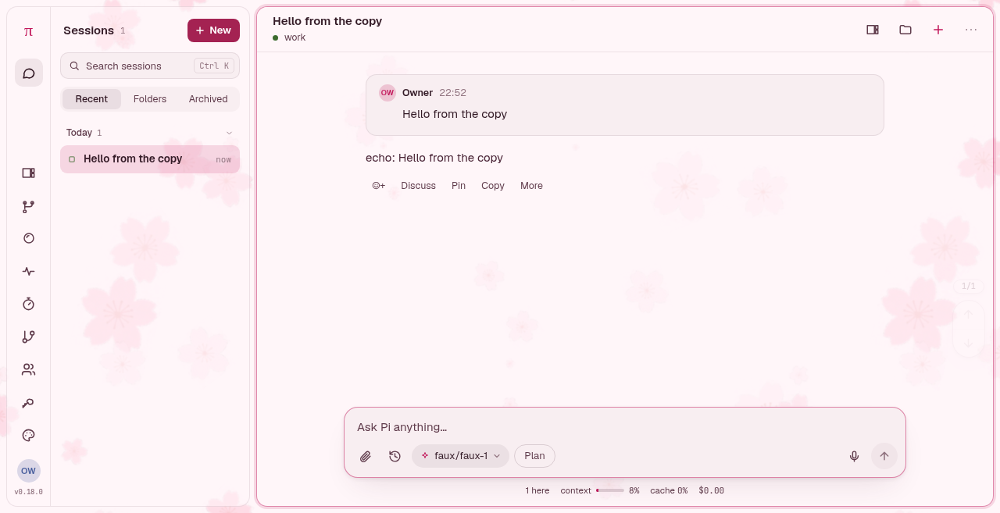
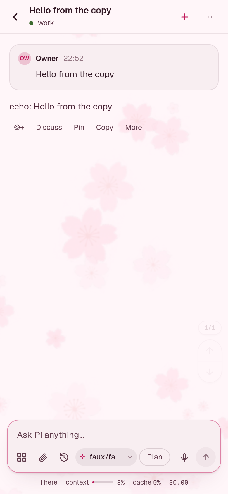

# Pink Sakura

A light pink theme for [Pi Pocket](https://github.com/TannerMidd/pi-pocket), with a seamless sakura
wallpaper.

On a phone:

The blossoms are cut from a generated render and scattered on a torus, so the 1024 px tile repeats with
no seam. It tiles in the gaps between the tiled windows and shows through them: the sidebar and the
conversation are half transparent. The palette travels with the theme (blush-white ground, plum text,
deep pink accent), so choosing it brings both the colours and the garden.

## Install

Copy the `pink-sakura/` folder into Pi Pocket's `themes/` folder (the data folder, usually
`~/.pi-pocket/themes/`), then choose **Pink Sakura** in Appearance → Theme. Installing from the
extension gallery does the same.

## Files

| File | What |
| --- | --- |
| `theme.json` | Name, description, `themeApi` 1, `minPocket` 0.14.0 |
| `theme.css` | The wallpaper, the tiling, the translucent windows, and code colours for a blush ground |
| `colors.toml` | The Omarchy-format palette |
| `images/sakura-tile.png` | The 1024 px seamless tile |
